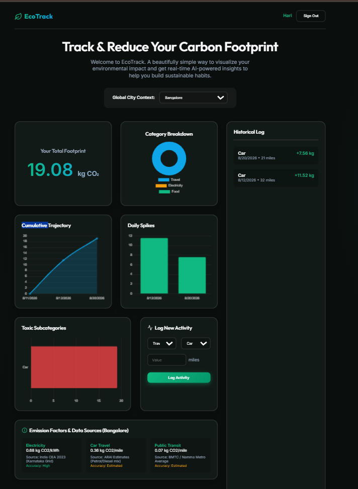
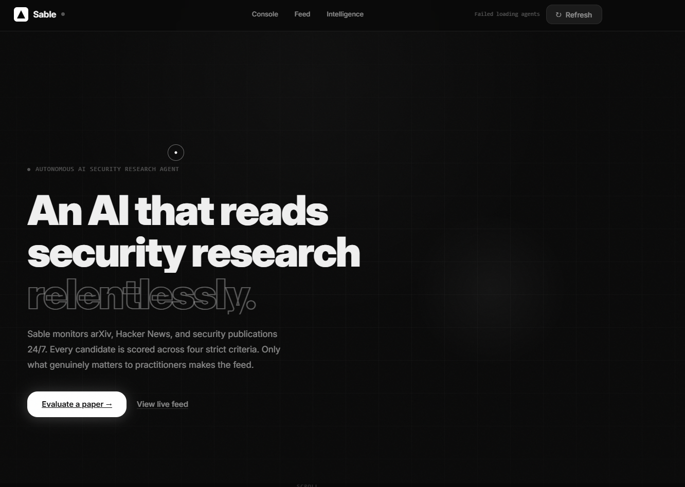
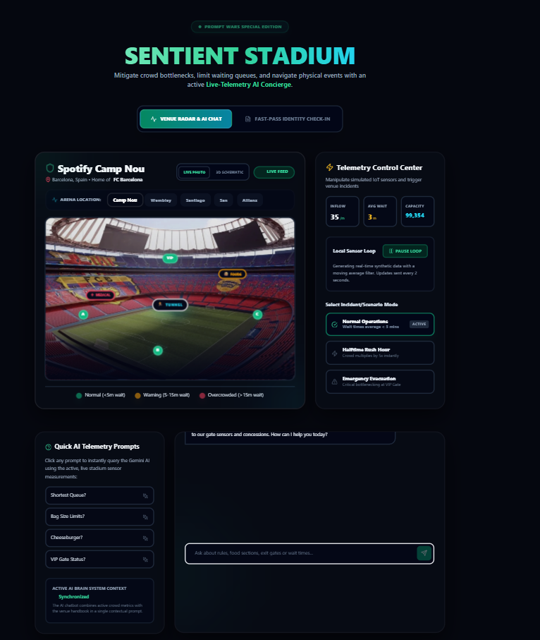
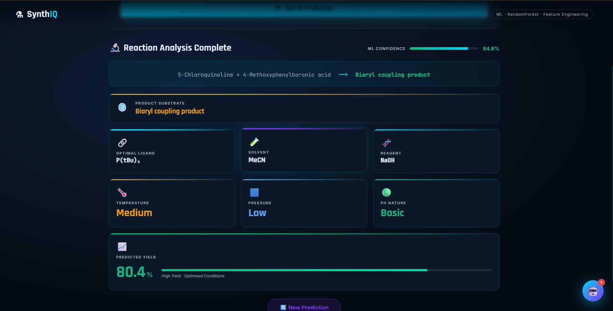

 

# S. MANIDEEP RAO

### AI / ML · GENERATIVE AI · INTELLIGENT SOFTWARE

*Curious by nature. Builder by practice. Engineer in progress.*

[GitHub](https://github.com/manideep997) · [LinkedIn](https://www.linkedin.com/in/suranenimanideep/) · [Portfolio](https://manideepsuraneni.vercel.app/)

---

## 01 / THE BUILDER

I'm an Electronics and Communication Engineering undergraduate at **Amrita Vishwa Vidyapeetham**, interested in turning ideas into practical AI systems and thoughtfully designed software.

I enjoy working where machine learning meets real-world problems—from intelligent applications and agent-based systems to interfaces that make complex information easier to understand.

`AI & ML` `Generative AI` `LLM Applications` `Full-Stack Development` `Open Source`

---

## 02 / SELECTED WORK

*Four projects. Four different problems. One goal: build technology that is useful.*

### 🌿 EcoTrack
**Make your carbon footprint visible. Make change actionable.**

An environmental dashboard for exploring carbon emissions through category breakdowns, historical activity, cumulative trends, and contextual insights.

**🏆 Achievement:** 76th rank in Virtual Prompt Wars

[↗ Explore EcoTrack](https://carbon-platform-two.vercel.app/)

---

### ◉ Sable — AI Security Research Agent
**Research intelligence, designed for discovery.**

An AI agent project focused on surfacing and evaluating security research, helping make relevant technical information easier to explore.

[↗ Explore Sable](https://sable-agent-production.up.railway.app/)

---

### 🏟️ Sentient Stadium
**Smarter experiences for live environments.**

A hackathon project exploring venue telemetry, crowd-flow awareness, interactive assistance, and AI-supported stadium experiences.

[↗ Explore Sentient Stadium](https://virtual-prompt-wars-manideep.vercel.app/)

---

### 🧪 SynthIQ
**Where machine learning meets chemical reaction prediction.**

An ML-focused application presenting predicted chemical reaction outcomes through feature-engineered inputs and a visual analysis interface.

[↗ Explore SynthIQ](https://synth-iq-chi.vercel.app/)

---

## 03 / THE TOOLKIT

| DOMAIN | TECHNOLOGIES |
|---|---|
| Languages | Python · C · JavaScript · MATLAB |
| AI / ML | Machine Learning · Generative AI · LLM Applications · Computer Vision · OpenCV |
| Development | React · Next.js · Node.js · FastAPI |
| Tools | Git · GitHub |
| Embedded Systems | ESP32 · Arduino |

---

## 04 / GITHUB, IN NUMBERS

 

---

## 05 / ACTIVITY

---

## 06 / OPEN TO WHAT'S NEXT

I'm interested in collaborating on AI-powered products, intelligent applications, open-source projects, and engineering challenges that have real-world impact.

**Have an interesting idea? Let's connect.**

[GitHub](https://github.com/manideep997) · [LinkedIn](https://www.linkedin.com/in/suranenimanideep/) · [Portfolio](https://manideepsuraneni.vercel.app/)

*Building thoughtfully. Learning continuously. Shipping with purpose.*

